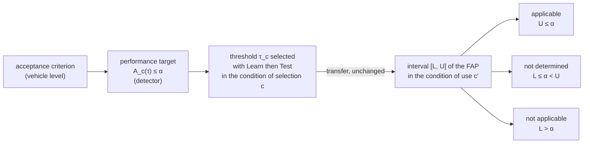
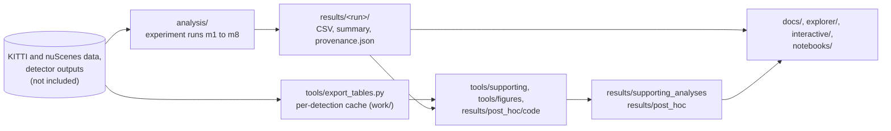

# Applicability of performance targets across triggering conditions in LiDAR object detection

[](https://doi.org/10.5281/zenodo.23495356)
[](https://github.com/milinpatel07/lidar-performance-target-applicability/actions/workflows/checks.yml)
[](https://milinpatel07.github.io/lidar-performance-target-applicability/)

Code, recorded results, detector provenance and interactive material of the paper

> Milin Patel and Rolf Jung. *Uncertainty Evaluation to Support Safety of the Intended Functionality Analysis for
> Determining the Applicability of Performance Targets Across Triggering Conditions in ML-Based LiDAR Object
> Detection.* Submitted, 2026.

The paper itself is not part of this repository. Its numbers are listed with their source files in
[`docs/paper_map.md`](docs/paper_map.md), and a check recomputes them from the files on every push.

## The idea in one paragraph

A machine-learning object detector can meet a performance target derived for SOTIF analysis (ISO 21448), here a limit
α on the share of wrong detections among the detections it passes on, by rejecting detections whose uncertainty
exceeds a threshold τ. A threshold selected with a statistical guarantee on data of one condition carries that
guarantee only for data distributed like its selection data. A SOTIF analysis, however, has to know whether the target
is met under every **triggering condition**. This repository implements and evaluates the **applicability test**: the
threshold selected in the *condition of selection* is used unchanged in the *condition of use*, an interval of the false
acceptance proportion there decides at a stated error probability whether the target is **applicable**, **not
applicable** or **not determined**, and a lower bound gives the number of independent recorded units an applicable
outcome needs.



The full explanation, with the statistics, the four changes in the detections that can make a transferred threshold
fail, the meaning of each outcome for the safety argument and an index from paper sections to files, is
[`docs/concept.md`](docs/concept.md).

## Try it

| page | what you can do |
|---|---|
| [Applicability test calculator](https://milinpatel07.github.io/lidar-performance-target-applicability/interactive/test.html) | enter the number of units, the estimated FAP, α and δ, and get the selection p-value, the interval [L, U], the outcome and the minimum number of units; reproduce a recorded interval of the sequence-level evaluation |
| [Independent units](https://milinpatel07.github.io/lidar-performance-target-applicability/interactive/units.html) | the zero-failure bound (Eq. 5 of the paper) with the recorded test units of every condition, counted as frames, scenes and drives |
| [Separation and FAP](https://milinpatel07.github.io/lidar-performance-target-applicability/interactive/separation.html) | move a threshold along the recorded ROC and FAP curves of the condition of selection and of use |
| [Four changes in the detections](https://milinpatel07.github.io/lidar-performance-target-applicability/interactive/concept.html) | a schematic (no data) showing why AUROC can stay unchanged while the FAP at a transferred threshold rises |
| [Results browser](https://milinpatel07.github.io/lidar-performance-target-applicability/explorer/) | every recorded outcome by pair of conditions, indicator, limit, split and evaluation, with its source row |

The pages run in the browser without installation; their sources are in [`interactive/`](interactive/) and
[`explorer/`](explorer/).

## Where to start

| I want to | go to |
|---|---|
| understand the concept | [`docs/concept.md`](docs/concept.md) |
| look up a term or a column name | [`docs/glossary.md`](docs/glossary.md) |
| follow the method step by step, as implemented | [`docs/method.md`](docs/method.md) |
| find the file behind a number, table or figure of the paper | [`docs/paper_map.md`](docs/paper_map.md) |
| know what each result file holds | [`docs/results.md`](docs/results.md) |
| read all result tables in one document | [`docs/supplementary/supplementary.pdf`](docs/supplementary/supplementary.pdf) |
| know which data, detectors, checkpoints and software were used | [`docs/data.md`](docs/data.md), [`docs/provenance.md`](docs/provenance.md) |
| rerun an experiment or a figure | [`docs/reproduce.md`](docs/reproduce.md), [`docs/pipeline.md`](docs/pipeline.md) |
| check the predictions fixed before any outcome was computed | [`docs/study_protocol/`](docs/study_protocol/) |
| work with the results in Python | [`notebooks/explore_results.ipynb`](notebooks/explore_results.ipynb) |
| see what changed between versions | [`CHANGELOG.md`](CHANGELOG.md) |

## What the recorded results show

The study examines three changes of condition in both directions on two datasets: near and far distance (KITTI and
nuScenes), clear weather and rain (nuScenes), and, as a control, KITTI with its detector against nuScenes with its
detector. Far distance and rain are treated as potential triggering conditions. The limits 10⁻², 10⁻³ and 10⁻⁴ define the
performance targets (**target limits**); 0.05† and 0.1† (**exploratory limits**) show at which limits the test reaches a
decision and define no performance target. All five limits, δ = 0.05 and the conditions were recorded with a date before
any outcome was computed. KITTI results apply the KITTI rule (detections in unannotated regions or on vans are left out).

1. **Counted in recorded sequences, the data decide almost nothing.** Frames of one recorded sequence (a nuScenes scene
   or a KITTI drive) are not independent. In the **sequence-level evaluation**, with the sequence as the independent unit,
   5 of the 240 transfer outcomes were applicable or not applicable, all on nuScenes and applicable at 0.1†, and no
   transfer was not applicable. A KITTI selection part holds 20 drives (22 for the change of dataset and detector) and a
   nuScenes rain part 9 to 12 scenes, while selecting a threshold at 10⁻² needs at least 299 independent units
   ([m7](results/m7_scene_split/m7_scene_split_summary.txt), [m8](results/m8_kitti_drive_split/summary.txt)).
2. **Counted in frames, transfers were not applicable.** In the **frame-level evaluation**, the threshold for the spatial
   indicator selected with the nuScenes detector on nuScenes was not applicable with the KITTI detector on KITTI on all
   five splits at 10⁻², 0.05† and 0.1†. After transfers into far distance and into rain, the outcome was not applicable on
   at least four of five splits at 0.1† for at least one indicator
   ([outcome table](docs/results.md#outcomes-over-the-five-splits)). The paper reports these with the caveat that the stated
   error probability is not guaranteed with dependent frames.
3. **A transferred threshold that met 10⁻² rejected most correct detections.** A limit on accepted wrong detections can be
   met by accepting almost nothing (Eq. 3 of the paper), so every applicable outcome is reported with its **retention**,
   the share of correct detections accepted: at most 29 % (28.5 %) for a transferred threshold at 10⁻²
   ([retention](results/supporting_analyses/retention_applicable_cells.csv)).
4. **Unchanged separation did not mean an unchanged FAP (rain).** In rain the AUROC of the existence indicator did not
   decrease (0.844 clear, 0.856 rain, test part of split 0), yet the threshold transferred from clear weather at 0.1† was not
   applicable in rain on four of five splits; rain holds more wrong detections, and they are spread differently over frames
   ([shares](results/supporting_analyses/wrong_share_and_median_split0.csv)). A post-hoc sequence bootstrap, not part of the
   paper, gives the difference 0.012 the 95 % interval [−0.030, 0.051] ([`results/post_hoc/`](results/post_hoc/)).
5. **The number of independent units needed can be computed before recording.** Showing a limit met at error probability
   δ′ needs at least n ≥ ln δ′ / ln(1 − α) units without a false acceptance: 299 for selecting (δ′ = δ) and 368 for
   testing (δ′ = δ/2) at 10⁻², 2,995 for selecting at 10⁻³ ([`docs/concept.md`](docs/concept.md)).

## How the repository is organised



```
analysis/          experiment scripts m1 to m8 and the statistics they share (they load each other by file name)
  recorded_versions/   earlier script versions that produced the first runs (hash-checked)
  SCRIPT_VERSIONS.md   which script file produced which recorded run
results/           recorded results, one folder per run, each with provenance.json (script version, input SHA-256)
  supporting_analyses/ tables computed by tools/ from the per-detection cache
  post_hoc/            analyses added after the paper's analyses, with the scripts that produced them
configs/           configuration of each run; detectors/ holds the detector configurations (OpenPCDet)
docs/              concept, method, glossary, paper map, results guide, data, provenance, reproduction, pipeline,
                   supplementary material, study protocol
interactive/       browser pages: test calculator, units, separation, schematic of the four changes
explorer/          results browser
notebooks/         notebook that rebuilds the outcome tables from results/
tools/             export of the per-detection cache, supporting analyses, figure scripts, checks, data builders
MANIFEST.sha256    SHA-256 of every file
```

| run | what it computes | results |
|---|---|---|
| m1 | KITTI distance with the blended score of the detection pipeline (precursor of m2) | [`results/m1_range_kitti`](results/m1_range_kitti/) |
| m2 | KITTI distance with the spatial indicator u_s and the existence indicator u_e | [`results/m2_indicators_kitti`](results/m2_indicators_kitti/) |
| m3 | nuScenes distance with u_s and u_e | [`results/m3_range_nuscenes`](results/m3_range_nuscenes/) |
| m4 | change of dataset and detector, one split | [`results/m4_dataset_shift`](results/m4_dataset_shift/) |
| m5 | frame figure only; no result folder | (none) |
| m6 | KITTI distance with and without the KITTI rule; change of dataset and detector on five splits; nuScenes weather | [`results/m6_protocol_seeds_weather`](results/m6_protocol_seeds_weather/) |
| m7 | nuScenes distance and weather divided by recorded scene: third run and sequence-level evaluation | [`results/m7_scene_split`](results/m7_scene_split/) |
| m8 | KITTI distance and change of dataset and detector divided by recorded KITTI drive | [`results/m8_kitti_drive_split`](results/m8_kitti_drive_split/) |
| supporting | retention, changes in the detections, intervals, common threshold, recall, annotation checks, figure data | [`results/supporting_analyses`](results/supporting_analyses/) |
| post hoc | not in the paper: a sequence test of the per-frame FAP (Method A), a betting interval (Method B), sequence-bootstrap AUROC intervals, the epoch check | [`results/post_hoc`](results/post_hoc/) |

## Checks that run without data

```bash
pip install -r requirements.txt
python3 tools/check_paper_numbers.py                     # numbers of the paper against the files
python3 tools/supplementary/make_supplementary.py --check # numbers of the supplementary against the files
python3 tools/build_explorer_data.py --check             # browser data against the files
python3 interactive/build_data.py --check                # data of the interactive pages against the files
python3 tools/test_stats_js.py                           # browser statistics against the Python implementation (needs node)
sha256sum -c MANIFEST.sha256                             # every file against the manifest
cd analysis && python3 m1_range_kitti.py --selftest && python3 m3_range_nuscenes.py --selftest
```

GitHub Actions runs these checks on every push ([`.github/workflows/checks.yml`](.github/workflows/checks.yml)).
Rerunning the experiments needs the datasets and the detector outputs: [`docs/reproduce.md`](docs/reproduce.md).

## Data and detectors

No KITTI or nuScenes data is included: no point clouds, images, annotations, detector outputs, per-detection tables or
checkpoints, and no figure that shows dataset images. The scripts read the datasets under their own licences and the
outputs of the detector ensembles ([`docs/data.md`](docs/data.md)). [`results/INPUT_HASHES.md`](results/INPUT_HASHES.md)
gives the SHA-256 of every input file, and [`docs/provenance.md`](docs/provenance.md) the toolbox version, detector
configurations, training runs and the SHA-256 of every checkpoint that inference loaded.

## Versions and citation

The repository is archived on Zenodo; the concept DOI [10.5281/zenodo.23495356](https://doi.org/10.5281/zenodo.23495356)
resolves to the latest archived version. The recorded results of version 1.0.0 are unchanged in every later version, and
[`CHANGELOG.md`](CHANGELOG.md) lists what each version added. Citation metadata: [`CITATION.cff`](CITATION.cff).

## Licence

Code (`analysis/`, `tools/`, `explorer/` and `interactive/` pages and scripts, notebook code, `results/post_hoc/code/`,
`.github/`): MIT, see [`LICENSE`](LICENSE). Results, data files of the pages, configurations and documentation: CC
BY-NC-SA 4.0, see [`LICENSE-results`](LICENSE-results), as required by the dataset licences. Detector configurations in
`configs/detectors/`: Apache License 2.0 (OpenPCDet).
