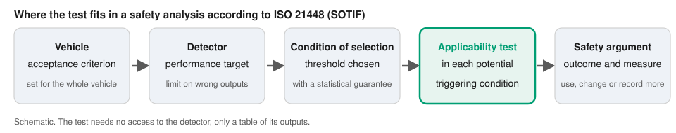
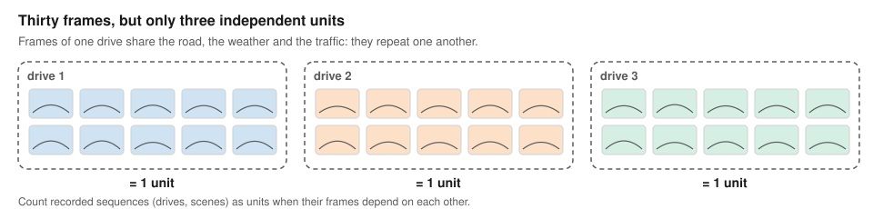
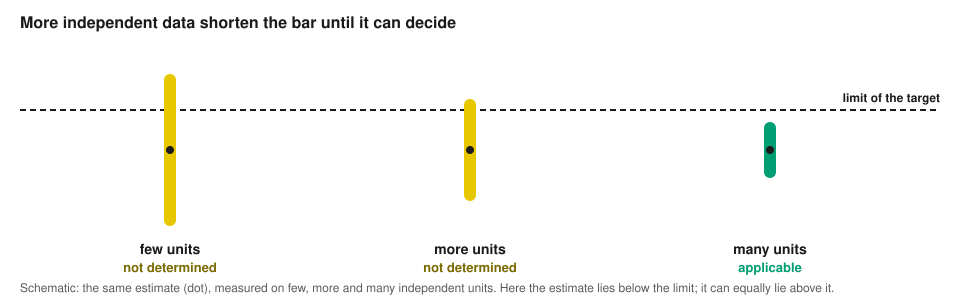

# Applicability of performance targets across triggering conditions

[](https://doi.org/10.5281/zenodo.23495356)
[](https://github.com/milinpatel07/lidar-performance-target-applicability/actions/workflows/checks.yml)
[](https://milinpatel07.github.io/lidar-performance-target-applicability/)

**A statistical test for ISO 21448 (SOTIF): does an uncertainty threshold of a machine-learning component, selected
under one condition, still meet its performance target under a triggering condition? The applicability test answers
this with recorded data.**



| you are | start here |
|---|---|
| new to the topic (student, teacher, anyone curious) | [the idea in two minutes](https://milinpatel07.github.io/lidar-performance-target-applicability/story.html): eight scenes, no formulas |
| building a perception system | [Try it](#try-it), then the [step-by-step guide](docs/guides/apply-to-your-detector.md) |
| writing or reviewing a safety argument | [outcomes in a safety argument](docs/guides/outcomes-in-a-safety-argument.md) and [how much data a condition needs](docs/guides/plan-recording.md) |
| a researcher | [the test in one page](docs/concept.md) and [the case study](case_study/README.md) |

## The problem

A machine-learning component of an automated vehicle, for example an object detector, can pass on only the outputs
whose uncertainty lies at or below an **uncertainty threshold**. The threshold is set so that a **performance target**
is met: the **false acceptance proportion (FAP)**, the share of wrong outputs among the passed-on outputs of a frame
averaged over frames, stays at or below a limit, for example 1 %. The threshold is set on recorded data of one
condition, the **condition of selection** (for example clear weather), and its statistical guarantee holds only for
data distributed like those. The condition in which it is then used is the **condition of use**.

A safety analysis according to ISO 21448 (safety of the intended functionality, SOTIF) asks whether the target still
holds under each **potential triggering condition** the analysis identifies, for example rain or far distance.
An unchanged AUROC does not answer this: the AUROC measures how well the uncertainty separates correct from wrong
outputs over all thresholds, not the FAP at one fixed threshold.



## What the test does

It keeps the threshold unchanged, applies it to recorded data of the new condition, and gives one of four outcomes:

| outcome | meaning | what follows |
|---|---|---|
| **applicable** | evidence that the target is met with this threshold | use the threshold there, if a second target on missed objects is also met |
| **not applicable** | evidence that the target is not met with this threshold | a threshold for that condition (needs a run-time signal for it), one threshold for several conditions, a restricted operational design domain, or a measure in tracking, fusion or motion planning |
| **not determined** | no statement: the data are too few, or the FAP lies close to the limit | record more independent data; the condition stays not verified |
| **no threshold selected** | the lowest (strictest) candidate threshold already fails in the condition of selection | record more data there, or ask for the target to be reallocated at vehicle level |

An applicable or not applicable outcome is wrong with probability at most δ/2 (δ is chosen by the user, 0.05 by
default), provided the units of the data are independent: frames only if they do not depend on each other, otherwise
recorded sequences. The test also gives the minimum number of independent units a condition needs for an applicable
outcome, so that a recording can be planned. Each applicable outcome comes with its **retention**, the share of
correct outputs the threshold passes on, because a threshold that passes on almost nothing meets any target.



More independent units shorten the interval until it lies wholly on one side of the limit. In the sketch below the
estimate lies below the limit, so the decision is applicable; it can equally end above the limit (not applicable).



[`docs/concept.md`](docs/concept.md) explains the test in one page, with the statistics.

**Intended for:** safety engineers who build the argument for each triggering condition, perception developers who
choose thresholds, and assessors who review the evidence. The test needs a table of outputs with a frame id, an
uncertainty value and a correct/wrong label; it needs no access to the model itself. The statistics apply to any
component whose outputs per frame are passed on or rejected by a threshold; the case study covers LiDAR car detection
only.

## Try it

- **In the browser**, without installation: the [walk-through](https://milinpatel07.github.io/lidar-performance-target-applicability/interactive/walkthrough.html)
  explains the test in seven steps, and [your own data](https://milinpatel07.github.io/lidar-performance-target-applicability/interactive/own-data.html)
  runs it on a CSV file that stays on your computer.
- **In Python** (3.9 or later; needs only NumPy):

  ```bash
  git clone https://github.com/milinpatel07/lidar-performance-target-applicability
  cd lidar-performance-target-applicability
  pip install ./package
  python -m applicability_test package/examples/detections_example.csv --selection-condition clear --use-condition rain --alpha 0.05
  ```

  The sample file holds synthetic detections of two conditions, `clear` and `rain`. The command selects a threshold
  for the target "at most 5 % wrong" on the `clear` data, tests it on the `rain` data and prints
  `outcome: not applicable`. For your own detector, replace the file by a table of its outputs
  ([format and API](package/README.md), [step by step](docs/guides/apply-to-your-detector.md)).

## Evidence: a case study on public driving data

The paper below applies the test to two ensembles of four PointPillars networks, one on KITTI and one on nuScenes,
for changes of distance, of weather, and of dataset and detector:

- Counted per recorded drive or scene, which is the independent unit, neither public dataset is large enough to show
  that any of the target limits of the study is met, and no transfer had a not applicable outcome.
- Counted per frame (frames of one drive depend on each other, so these outcomes do not carry the stated error
  probability), thresholds were not applicable at the 1 % target after a change of dataset and detector and, on some
  splits, of distance; after a change into rain only at looser exploratory limits, which define no target. Transferred
  thresholds applicable at 1 % had a retention of at most 29 %.
- Also counted per frame, the AUROC did not decrease in rain, yet the threshold transferred from clear weather was not
  applicable at the exploratory limit 10 % on at least four of five splits for at least one indicator.

[`case_study/`](case_study/README.md) holds the experiments, the recorded results, every number of the paper with its
source file, and one command that checks them all and redraws the figures. The
[results browser](https://milinpatel07.github.io/lidar-performance-target-applicability/explorer/) shows every recorded
outcome; [`docs/concept.md`, section 7](docs/concept.md#7-limitations-of-the-study) the limitations.

## What is where

```
package/       the test as a Python package, with an example and tests
site/          the browser pages (published on GitHub Pages)
docs/          the test in one page, questions and answers, glossary, guides
tests/         tests of the browser pages against the Python code
case_study/    the case study: experiments, recorded results, checks, tools, its own documentation
```

No KITTI or nuScenes data is included. [`docs/README.md`](docs/README.md) lists every documentation page;
[`docs/faq.md`](docs/faq.md) answers common questions.

## Citation

If you use the test, the package or the results, please cite the paper and this repository (concept DOI
[10.5281/zenodo.23495356](https://doi.org/10.5281/zenodo.23495356); metadata in [`CITATION.cff`](CITATION.cff), shown
by GitHub under "Cite this repository"):

> Milin Patel and Rolf Jung. *Uncertainty Evaluation to Support Safety of the Intended Functionality Analysis for
> Determining the Applicability of Performance Targets Across Triggering Conditions in ML-Based LiDAR Object
> Detection.* Submitted, 2026.

```bibtex
@unpublished{patel2026applicability,
  author = {Patel, Milin and Jung, Rolf},
  title  = {Uncertainty Evaluation to Support Safety of the Intended Functionality Analysis for Determining the
            Applicability of Performance Targets Across Triggering Conditions in ML-Based LiDAR Object Detection},
  note   = {Submitted},
  year   = {2026}
}
@software{patel2026applicability_code,
  author  = {Patel, Milin and Jung, Rolf},
  title   = {Code and results: Applicability of Performance Targets Across Triggering Conditions in ML-Based LiDAR
             Object Detection},
  version = {2.0.0},
  year    = {2026},
  doi     = {10.5281/zenodo.23495356},
  url     = {https://github.com/milinpatel07/lidar-performance-target-applicability}
}
```

[`CHANGELOG.md`](CHANGELOG.md) lists the changes per version and maps older paths to the current ones. Questions and
error reports: [GitHub issues](https://github.com/milinpatel07/lidar-performance-target-applicability/issues);
[`CONTRIBUTING.md`](CONTRIBUTING.md) explains what can change.

## Licence

Code: MIT ([`LICENSE`](LICENSE)). Results, data files of the pages, configurations and documentation: CC BY-NC-SA 4.0
([`LICENSE-results`](LICENSE-results)), as the dataset licences require. Detector configurations in
`case_study/configs/detectors/`: Apache License 2.0 (OpenPCDet).
