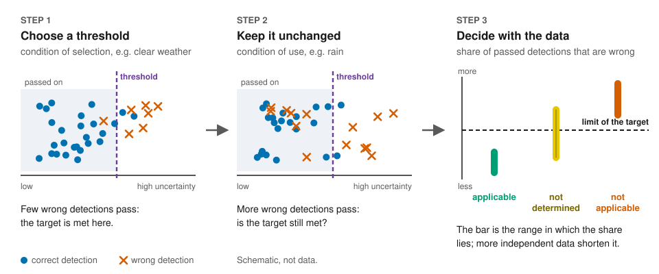

# Applicability of performance targets across triggering conditions

[](https://doi.org/10.5281/zenodo.23495356)
[](https://github.com/milinpatel07/lidar-performance-target-applicability/actions/workflows/checks.yml)
[](https://milinpatel07.github.io/lidar-performance-target-applicability/)

A LiDAR object detector can pass on only the detections whose uncertainty lies at or below an **uncertainty
threshold**. A **performance target** sets a limit on the share of wrong detections among the passed-on ones, for
example at most 1 %, and the threshold is chosen so that this limit is met. It is chosen on recorded data of one
condition, the **condition of selection** (for example near distance), and its statistical guarantee holds only for
data distributed like those. A safety analysis according to ISO 21448 (safety of the intended functionality, SOTIF)
asks whether the target also holds under a **triggering condition**; far distance and rain are potential triggering
conditions for a LiDAR detector.

The **applicability test** answers this question with recorded data:



This repository contains the test as a Python package and as browser pages, its documentation, and the case study of
the paper

> Milin Patel and Rolf Jung. *Uncertainty Evaluation to Support Safety of the Intended Functionality Analysis for
> Determining the Applicability of Performance Targets Across Triggering Conditions in ML-Based LiDAR Object
> Detection.* Submitted, 2026. ([How to cite](#citation))

## Try it

In the browser, without installation: the [walk-through](https://milinpatel07.github.io/lidar-performance-target-applicability/interactive/walkthrough.html),
the [test on your own CSV file](https://milinpatel07.github.io/lidar-performance-target-applicability/interactive/own-data.html)
(the file stays on your computer) and [all pages](https://milinpatel07.github.io/lidar-performance-target-applicability/).

In Python (3.9 or later; the package needs only NumPy):

```bash
git clone https://github.com/milinpatel07/lidar-performance-target-applicability
cd lidar-performance-target-applicability
pip install ./package
python -m applicability_test package/examples/detections_example.csv --selection-condition clear --use-condition rain --alpha 0.05
```

The CSV file holds synthetic detections of two conditions, `clear` and `rain`, one row per detection (columns `frame`,
`condition`, `part`, `u`, `correct`). The command selects a threshold on the `clear` data for the limit α = 5 % and
tests it on the `rain` data, the condition of use. It prints the threshold, the interval [L, U] (defined below), the
retention and `outcome: not applicable`. For your own detector, replace the file by a table of its detections
([format and API](package/README.md), [step by step](docs/guides/apply-to-your-detector.md)).

## How to read the outcome

The test estimates the **false acceptance proportion (FAP)** in the condition of use: in each frame the share of
wrong detections among the passed-on ones, averaged over the frames. It gives an interval [L, U] in which the FAP lies
at confidence 1 − δ (δ = 0.05 by default) and compares it with the limit α:

| outcome | when | what it means | what follows |
|---|---|---|---|
| **applicable** | U ≤ α | evidence that the target is met in the condition of use with this threshold | use the threshold, if the share of annotated objects that reach the motion planner also meets a target on missed objects |
| **not applicable** | L > α | evidence that the target is not met with this threshold | select a threshold for the condition of use (needs a run-time signal for it) or one threshold for several conditions, or restrict the operational design domain, or add a measure in tracking, fusion or motion planning |
| **not determined** | L ≤ α < U | no statement: too few data, or the FAP lies close to α | record more independent data; until then the condition of use is not verified |
| **no threshold selected** | the lowest (strictest) candidate threshold fails in the condition of selection | no threshold to transfer | record more data in the condition of selection, or request a new allocation of α at vehicle level |

- **Error probability.** Applicable and not applicable are each wrong with probability at most δ/2, if the units of
  the data are independent. Consecutive frames of one drive are not; count recorded sequences (drives, scenes).
- **Retention.** A threshold that passes on almost nothing meets any limit. Each applicable outcome therefore comes
  with its retention, the share of correct detections that the threshold passes on.
- **Amount of data.** Showing that a limit α is met needs at least ln δ′ / ln(1 − α) independent units without a
  wrong passed-on detection (δ′ = δ for selecting, δ/2 for testing): 299 to select and 368 to test at α = 1 %,
  δ = 0.05. [`docs/guides/plan-recording.md`](docs/guides/plan-recording.md) computes this before a recording.

More: [the test in one page](docs/concept.md), [questions and answers](docs/faq.md),
[outcomes in a safety argument](docs/guides/outcomes-in-a-safety-argument.md). The table follows Table 5 of the paper.

## The case study of the paper

Two ensembles of four PointPillars networks each, one trained on KITTI and one on nuScenes, and three changes of
condition in both directions: near and far distance, clear weather and rain, and KITTI with its detector against
nuScenes with its detector. The target limits 1 %, 0.1 % and 0.01 %, the exploratory limits 5 % and 10 % (no
performance target) and δ = 0.05 were fixed before any outcome was computed. Main findings:

- **Sequence-level evaluation** (recorded sequences as units): neither dataset holds enough sequences to show that a
  target limit is met, and no transfer gave the outcome not applicable.
- **Frame-level evaluation** (frames as units, which overstates the evidence): after the transfer from nuScenes to
  KITTI the outcome at 1 % was not applicable on all five splits; after transfers into far distance and into rain it
  was not applicable at the exploratory limit 10 % on at least four of five splits. Transferred thresholds with the outcome applicable at 1 % passed
  on at most 29 % of the correct detections.
- In rain the AUROC of the existence indicator did not decrease, yet the threshold transferred from clear weather was
  not applicable at 10 % on four of five splits: an unchanged separation did not mean an unchanged FAP.

[`case_study/README.md`](case_study/README.md) gives every finding with its source file, the
[results browser](https://milinpatel07.github.io/lidar-performance-target-applicability/explorer/) every recorded
outcome, and [`docs/concept.md`, section 7](docs/concept.md#7-limitations-of-the-study) the limitations. To check every
number of the paper against the recorded results and redraw its figures (Python 3.10, the version of the recorded runs;
no dataset needed):

```bash
cd case_study
pip install -r environment/requirements.txt
python reproduce_paper.py
```

## What is where

```
package/       the test as a Python package, with an example and tests
site/          the browser pages (published on GitHub Pages)
docs/          the test in one page, questions and answers, glossary, guides
tests/         tests of the browser pages against the Python code
case_study/    the case study of the paper: experiments, recorded results, checks, tools, its own documentation
```

No KITTI or nuScenes data is included; [`case_study/results/INPUT_HASHES.md`](case_study/results/INPUT_HASHES.md) gives
the SHA-256 of every input file. [`docs/README.md`](docs/README.md) lists every documentation page.

## Citation

Please cite the paper and, for the code and results, this repository (concept DOI
[10.5281/zenodo.23495356](https://doi.org/10.5281/zenodo.23495356), which resolves to the latest archived version;
metadata in [`CITATION.cff`](CITATION.cff)):

```bibtex
@unpublished{patel2026applicability,
  author = {Patel, Milin and Jung, Rolf},
  title  = {Uncertainty Evaluation to Support Safety of the Intended Functionality Analysis for Determining the
            Applicability of Performance Targets Across Triggering Conditions in ML-Based LiDAR Object Detection},
  note   = {Submitted},
  year   = {2026}
}
@software{patel2026applicability_code,
  author  = {Patel, Milin and Jung, Rolf},
  title   = {Code and results: Applicability of Performance Targets Across Triggering Conditions in ML-Based LiDAR
             Object Detection},
  version = {2.0.0},
  year    = {2026},
  doi     = {10.5281/zenodo.23495356},
  url     = {https://github.com/milinpatel07/lidar-performance-target-applicability}
}
```

[`CHANGELOG.md`](CHANGELOG.md) lists the changes per version and maps the paths of versions up to 1.2.0 to the current
ones; no number, outcome or input hash of the recorded results of version 1.0.0 has changed since. Questions and error
reports: [GitHub issues](https://github.com/milinpatel07/lidar-performance-target-applicability/issues);
[`CONTRIBUTING.md`](CONTRIBUTING.md) explains what can change and which checks to run.

## Licence

Code: MIT ([`LICENSE`](LICENSE)). Results, data files of the pages, configurations and documentation: CC BY-NC-SA 4.0
([`LICENSE-results`](LICENSE-results)), as the dataset licences require. Detector configurations in
`case_study/configs/detectors/`: Apache License 2.0 (OpenPCDet). [`LICENSE-results`](LICENSE-results) lists which
folder falls under which licence.
