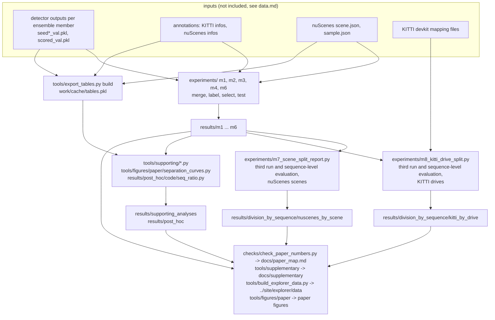
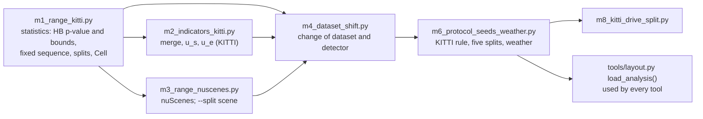

# Pipeline: which script reads what and writes what

This page shows, for readers who rerun or extend the case study, which script reads which file and writes which
file. Three levels of reproduction, from the cheapest to the most complete:

| level | needs | reproduces |
|---|---|---|
| 1. checks | this repository only | every number of the paper and of the supplementary against `results/`; the browser data; the manifest; the self-tests of the statistics |
| 2. tables and figures from recorded results | this repository only, plus pdflatex for the TikZ figures | Fig. 4 and Fig. 5 of the paper from the recorded CSVs, with the figure sources of 21 October 2026, whose label wording differs from the submitted figures ([`../tools/figures/paper/README.md`](../tools/figures/paper/README.md)); the supplementary figures and document; the m8 outcome counts |
| 3. experiment runs | KITTI and nuScenes validation data, the detector outputs, the KITTI devkit mapping files | every folder of `results/` (see [`reproduce.md`](reproduce.md)) |

## Data flow

Every run and every supporting script first recomputes recorded values and stops if one differs: each run rebuilds the
merged detections and compares the per-frame missed and false detections with the detection pipeline; m7 and m8 rerun
the frame-level evaluation and compare it with m3 and m6 byte for byte before the division by recorded sequence; each
supporting script compares the split-0 cells with `results/`; the post-hoc script compares 1,600 rows with the recorded
rows before it computes a new number.

## Which experiment script loads which

The scripts in `experiments/` load each other by file name, so they stay in one folder and are run from it.

A variant of the analysis replaces `m1.split_frames` (how the parts are drawn) or `m1.Cell` (the unit of the test) at run
time; the statistics in m1 are never edited.

## Outputs and the scripts that write them

| output | written by | input |
|---|---|---|
| `results/division_by_frame/kitti_distance_pilot` … `results/division_by_frame/kitti_rule_dataset_change_weather` | `experiments/m1` … `m6` | detector outputs, annotations |
| `results/division_by_sequence/nuscenes_by_scene` | `experiments/m3`, `m6` with `--split`, then `experiments/m7_scene_split_report.py` | as above, nuScenes metadata |
| `results/division_by_sequence/kitti_by_drive` | `experiments/m8_kitti_drive_split.py` | as above, KITTI devkit mapping |
| `results/supporting_analyses/*` | `tools/supporting/*.py`, `tools/table_and_figure_values.py`, `tools/figures/paper/separation_curves.py`, `tools/figures/make_figures.py` (distance bins), `tools/figures/paper/frame_figure/` (Fig. 1 facts and candidates) | per-detection cache, `results/` |
| `results/post_hoc/*` | `results/post_hoc/code/` | per-detection cache, `results/`, metadata |
| `docs/paper_map.md` | `checks/check_paper_numbers.py --write` | `results/` |
| `docs/supplementary/*` | `tools/supplementary/make_supplementary.py`, `tools/figures/supplementary/supplementary_figures.py` | `results/`, `docs/study_protocol/` |
| `../site/explorer/data/outcomes.json` | `tools/build_explorer_data.py` | `results/` |
| paper figures 2 to 6 | `tools/figures/paper/` (figure sources as of 21 October 2026; the submitted figures differ in label wording, listed in [`../tools/figures/paper/README.md`](../tools/figures/paper/README.md)) | `results/` (Fig. 2, 3 schematic) |
