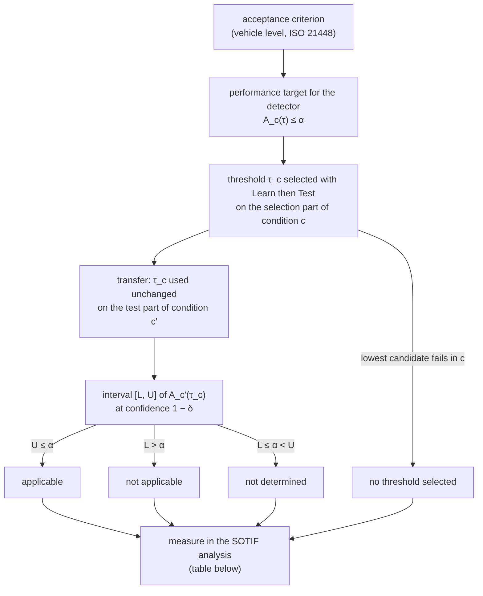

# The applicability test in one page

This page explains the applicability test for two readers who have not read the paper: a safety engineer who works
with ISO 21448 (SOTIF) and a machine learning researcher who works with uncertainty and object detection. It
paraphrases the paper and points to its sections, equations, tables and figures; it does not replace them. Single terms
are defined in [`glossary.md`](glossary.md), the scripts are described in [`../case_study/docs/method.md`](../case_study/docs/method.md), and the files that
hold the values of each section of the paper are listed in the
[index in `results.md`](../case_study/docs/results.md#paper-section-to-repository-index).

Interactive pages: [walk-through](https://milinpatel07.github.io/lidar-performance-target-applicability/interactive/walkthrough.html)
(all sections), [applicability test calculator](https://milinpatel07.github.io/lidar-performance-target-applicability/interactive/test.html)
(sections 1 and 3), [four changes in the detections](https://milinpatel07.github.io/lidar-performance-target-applicability/interactive/concept.html)
and [separation and FAP](https://milinpatel07.github.io/lidar-performance-target-applicability/interactive/separation.html)
(section 4), [independent units needed](https://milinpatel07.github.io/lidar-performance-target-applicability/interactive/units.html)
(section 5). The [results browser](https://milinpatel07.github.io/lidar-performance-target-applicability/explorer/) shows
every recorded outcome per split.

## 1. From the acceptance criterion to a measure

A car detector based on machine learning outputs boxes (detections). An ensemble of four separately trained networks
gives each detection an uncertainty value u, and a threshold τ rejects every detection with u > τ before it reaches the
motion planner. The question of the study is whether a threshold selected with a statistical guarantee under one
condition (for example near distance or clear weather) still meets its limit under another condition (far distance,
rain, or another dataset with its own detector). The guarantee of the selection holds only for data distributed like
the selection data (paper, Sect. 1), so the answer has to be tested in the second condition.



The steps, with the paper section that defines each:

1. **Acceptance criterion** (vehicle level). ISO 21448 requires the residual risk of a driving function to meet
   acceptance criteria. The study takes the limit α derived from them as given; it derives no value of α (Sect. 1.2).
2. **Performance target** for the detector: the false acceptance proportion (FAP) A_c(τ) of condition c must not
   exceed α (Sect. 3.1, Eq. 2). Section 2 of this page defines the FAP.
3. **Threshold τ_c**, selected with Learn then Test (LTT) on the selection part of the condition of selection c, so
   that A_c(τ_c) ≤ α holds with probability at least 1 − δ for the distribution of c (Sect. 3.2; section 3 of this page).
4. **Transfer**: τ_c is used unchanged on the test part of the condition of use c′ (Sect. 3.3).
5. **Interval** [L, U] of A_c′(τ_c) from the test part of c′, each bound at δ/2 (Sect. 3.3).
6. **Outcome** and the **measure** that follows (Sect. 6.1, Table 5):

| outcome | rule | what it means for the performance target in c′ | measure that follows |
|---|---|---|---|
| applicable | U ≤ α | evidence that the target is met in c′ with the transferred threshold; erroneous with probability at most δ/2 if the test units are independent | use the threshold in c′, provided the share of annotated cars that reach the motion planner meets a second target on missed objects |
| not applicable | L > α | evidence that the target is not met in c′ with the transferred threshold; erroneous with probability at most δ/2 if the test units are independent | detector supplier: select a threshold in c′ (this needs a run-time signal that c′ holds) or use one common threshold for several conditions; vehicle manufacturer: restrict the operational design domain (ODD) or the functionality, or add a measure in tracking, fusion or motion planning |
| not determined | L ≤ α < U | no claim; the data of c′ are too few or the FAP lies close to α, and an exceeded limit can lie behind this outcome | record further independent units (Eq. 5 gives the minimum) and treat c′ as not verified |
| no threshold selected | lowest candidate fails in c | the lowest candidate threshold fails in c with the available data, so no threshold carries the guarantee of the selection | record further independent units in c, or request a reallocation of α at vehicle level |

An outcome is a result for the detector as one system element. It does not classify scenarios, because tracking,
fusion and motion planning lie between the detector and a hazardous behaviour (Sect. 6.1). In the condition of
selection itself, the LTT guarantee is the evidence.

## 2. What is measured: per-frame share, FAP and pooled share

A detection is **accepted** if u ≤ τ and **rejected** otherwise. An accepted wrong detection is a **false acceptance**;
a rejected correct detection is **withheld**. For frame f and condition c (Sect. 3.1, Eq. 2):

- the **per-frame share** a_f(τ) is the share of false acceptances among the accepted car detections of c in f, and
  0 if the frame holds none;
- the **FAP** A_c(τ) is the expectation of a_f(τ) over the frames of c. It is a proportion, not a rate.

Three neighbouring quantities, kept apart throughout:

| quantity | definition | relation to the FAP |
|---|---|---|
| precision of a frame | share of correct detections among the accepted detections of the frame | a_f = 1 − precision of the frame |
| false discovery rate | expected share of wrong detections among accepted ones | the FAP is the false discovery rate computed per frame and averaged over frames |
| pooled share | share of wrong detections among all accepted detections of a condition taken together | every frame has equal weight in the FAP, every accepted detection in the pooled share, so the two differ when frames hold different numbers of accepted detections |

The per-frame form is used because the LTT bound applies to a mean of per-unit values in [0, 1].

**Why every applicable outcome carries its retention (Eq. 3).** A frame without accepted detections contributes
a_f = 0. The FAP is therefore at most the probability that a frame holds any accepted detection. A threshold so low
that almost no frame keeps a detection meets any limit, even if every accepted detection is wrong. The paper therefore
reports every applicable outcome with the **retention**, the share of the correct detections of the condition that the
threshold accepts (Sect. 3.1). In the frame-level evaluation, transferred thresholds with an applicable outcome at
10⁻² had a retention of at most 29 % on every split (Sect. 5.1; file
[`../case_study/results/supporting_analyses/retention_applicable_cells.csv`](../case_study/results/supporting_analyses/retention_applicable_cells.csv)).

**Why a bound over all frames refers to the recording mix (Eq. 4).** If every frame belongs to exactly one condition,
the FAP over all frames is the mean of the per-condition FAPs weighted with the share π_c of frames in each condition.
A bound on the FAP over all frames therefore holds for the mix of the recording campaign, which need not be the mix in
operation. A threshold that meets α in every condition meets it under any mix, provided that the frames within each
condition are distributed in operation as in the recording. Weather and dataset assign each frame to one condition.
Distance is assigned per detection, and one frame can hold near and far detections, so this premise fails for
distance (Sect. 3.2).

## 3. Selecting a threshold and testing it

**The Hoeffding-Bentkus (HB) p-value** (Sect. 3.2, unnumbered). For n units with mean  of the per-unit values in
[0, 1], the p-value for the null hypothesis "the mean exceeds α" is

```math
p=\min\Bigl\{\exp\bigl(-n\,h(\min(\hat{A},\alpha),\alpha)\bigr),\; e\,P\bigl(\mathrm{Bin}(n,\alpha)\le\lceil n\hat{A}\rceil\bigr)\Bigr\},
\qquad h(v,w)=v\ln\tfrac{v}{w}+(1-v)\ln\tfrac{1-v}{1-w}.
```

It holds for any distribution of the per-unit values in [0, 1] and requires independent and identically distributed
units. The count n includes units without accepted detections. Code: `hb_pvalue` in
[`../case_study/experiments/m1_range_kitti.py`](../case_study/experiments/m1_range_kitti.py).

**Fixed-sequence selection** (Sect. 3.2). The candidate thresholds are fixed in advance and taken in order from the
lowest upwards. A candidate **passes** if its HB p-value on the selection part of c is at most δ, and **fails**
otherwise. The selected threshold τ_c is the last candidate that passes before the first candidate that fails. If the
lowest candidate fails, no threshold is selected in c. A candidate above the first failure can pass (the FAP need not
rise monotonically with τ), but it is not selected. With independent selection units, this order bounds by δ the
probability that any selected candidate has an FAP above α. Code: `chain_index` in `case_study/experiments/m1_range_kitti.py`.

**The interval and the decision** (Sect. 3.3). On the test part of c′, the upper bound U inverts the HB p-value at
δ/2, and the lower bound L is one minus the same bound computed from the values 1 − a_f, so [L, U] is an interval at
confidence 1 − δ. For a given true FAP only one of the two erroneous outcomes is possible, so an applicable or not
applicable outcome is erroneous with probability at most δ/2 if the test units are independent draws from c′ and
independent of the selection units. This holds for each outcome on its own; a safety argument that relies on several
outcomes at once divides δ by their number. Code: `hb_upper` and `hb_lower` in `case_study/experiments/m1_range_kitti.py`.

## 4. Four changes in the detections, and which one AUROC shows

A transferred threshold is the same value on the indicator scale in both conditions. Four changes from c to c′ can make
it exceed α (Sect. 3.4):

| change | what differs in c′ |
|---|---|
| weaker separation | the indicator distributions of correct and wrong detections overlap more |
| more wrong detections | a larger share of wrong detections at unchanged distributions |
| shifted values | both kinds of detection lie at another position on the scale, so the same τ accepts a different share |
| different spread over frames | wrong detections are distributed differently over frames, for example concentrated in frames with few accepted detections |

The area under the ROC curve (AUROC) measures separation only. It does not depend on the share of wrong detections or
on the spread over frames, and an order-preserving rescaling of the indicator leaves it unchanged. Different spread over
frames can change the FAP while the pooled share stays the same.

The four transfers of Table 4 of the paper (one indicator each; shares over all validation frames, other values on the
test part of split 0, thresholds selected at the exploratory limit 0.1†):

| transfer (indicator) | AUROC | share of wrong detections | further change | shown by AUROC |
|---|---|---|---|---|
| near → far, KITTI (u_s) | 0.915 → 0.845 | 0.34 → 0.76 | none reported | weaker separation |
| near → far, nuScenes (u_s) | 0.729 → 0.655 | 0.19 → 0.51 | none reported | weaker separation |
| clear → rain, nuScenes (u_e) | 0.844 → 0.856 | 0.33 → 0.42 | different spread over frames: FAP 0.09 → 0.17, pooled share 0.12 → 0.17 | none |
| nuScenes → KITTI (u_s) | 0.749 → 0.905 | 0.35 → 0.55 | shifted values: median u_s of the correct detections 0.23 → 0.12 | none |

In rain both the pooled share and the FAP rose, the FAP more, so the spread of wrong detections over frames added to
the effect of more wrong detections (Sect. 5.2). Between the datasets u_s separated better on KITTI, yet the nuScenes
threshold lay high on the KITTI scale and the outcome was not applicable. The paper reports AUROC as point estimates;
the bootstrap intervals in [`../case_study/results/post_hoc/auroc_bootstrap.csv`](../case_study/results/post_hoc/auroc_bootstrap.csv) were added
post hoc. The source file of every value in this table is listed in the
[index](../case_study/docs/results.md#paper-section-to-repository-index).

## 5. The independent unit: frame or recorded sequence

The HB p-value and bounds assume independent units. Frames of one recorded sequence (a nuScenes scene of about 20 s or
a KITTI drive) share objects, weather and road, and consecutive annotated nuScenes frames are 0.5 s apart
(Sect. 4.3). The study therefore reports two evaluations and checks them with a third run, all with the same seeds
and limits:

| evaluation (paper term) | division into parts | independent unit | labels in the result files |
|---|---|---|---|
| frame-level evaluation | by frame | frame | the run files of m1 to m6 (no `split` column); m7 `variant` = `frame`; `split` = `frame`, `hb_unit` = `frame` in `division_by_sequence/nuscenes_by_scene/m3_frame/`; folder `division_by_sequence/kitti_by_drive/frame/` |
| sequence-level evaluation | by recorded sequence | recorded sequence; its value is the mean of a_f over its frames in the condition | m7 `variant` = `scene_scene_unit`, printed as "(ii)" in `m7_scene_split_summary.txt`; m3/m6 under `division_by_sequence/nuscenes_by_scene/*_scene/` `hb_unit` = `scene`; m8 `split` = `drive`, `hb_unit` = `drive` |
| third run | by recorded sequence | frame | m7 `variant` = `scene_frame_unit`, printed as "(i)"; m3/m6 under `division_by_sequence/nuscenes_by_scene/*_scene/` `hb_unit` = `frame`; m8 `split` = `drive`, `hb_unit` = `frame` |

The third run separates the effect of the division from the effect of the unit. Fig. 4 of the paper shows the
frame-level evaluation; the answers to the research questions state the sequence-level evaluation first, because
the dependence between frames requires it (Sect. 5.1, 6.1). In the frame-level evaluation, 168 of 240 transfer outcomes
were applicable or not applicable; in the sequence-level evaluation, 5 of 240, all applicable at 0.1† on nuScenes
(Sect. 5.1).

**Zero-failure bound** (Sect. 3.5, Eq. 5). Units without any false acceptance are the most favourable data for a
passing candidate. If the true FAP lies just above α, all n units are free of false acceptances with probability close
to (1 − α)ⁿ. Showing that α is met at error probability δ′ therefore needs at least n ≥ ln δ′ / ln(1 − α)
independent units per condition and part, with δ′ = δ = 0.05 for selecting and δ′ = δ/2 = 0.025 for testing. At
δ′ = 0.05 this is about 3/α (the rule of three). The bound is necessary, not sufficient: any unit with a false
acceptance raises the number. It does not apply to the outcome not applicable, which a few units with many false
acceptances can show. Code: `n_required` in `case_study/experiments/m1_range_kitti.py` (zero false acceptances in the HB p-value;
it returns the same values as Eq. 5 for the limits below).

| limit α | selecting (δ′ = 0.05) | testing (δ′ = 0.025) |
|---|---|---|
| 10⁻² | 299 | 368 |
| 10⁻³ | 2,995 | 3,688 |
| 0.05† | 59 | 72 |
| 0.1† | 29 | 36 |

Values from Eq. 5, rounded up; the paper states 299, 368 and 2,995 (Sect. 5.3), and section (d) of
[`../case_study/notebooks/explore_results.ipynb`](../case_study/notebooks/explore_results.ipynb) prints the table. The 150 nuScenes validation
scenes are fewer than the 299 that selection alone needs at 10⁻², and a selection part of 20 to 22 KITTI drives is
too small for any limit used here (Sect. 5.3; units per part in
[`../case_study/results/supporting_analyses/m8_drives_per_part.csv`](../case_study/results/supporting_analyses/m8_drives_per_part.csv) and
[`../case_study/results/division_by_sequence/nuscenes_by_scene/m7_scene_split_summary.txt`](../case_study/results/division_by_sequence/nuscenes_by_scene/m7_scene_split_summary.txt)).

## 6. The own-condition check

A threshold tested in its own condition of selection (c′ = c) with independent frames gives the outcome not applicable
only after an erroneous selection (probability at most δ) or an erroneous interval (at most δ/2). Its frequency is
therefore at most δ + δ/2 = 7.5 % and serves as a check of the selection (Sect. 3.3). For the nuScenes distance and
weather conditions, the outcome was not applicable in 0 of 112 own-condition outcomes with a selected threshold in the
frame-level evaluation and in 5 of 113 in the third run (Sect. 5.1; file
[`../case_study/results/division_by_sequence/nuscenes_by_scene/m7_scene_split.csv`](../case_study/results/division_by_sequence/nuscenes_by_scene/m7_scene_split.csv), `established` = `applied`). In the frame-level
evaluation, frames of one sequence lie in both parts, so the first frequency is weak evidence.

## 7. Limitations of the study

- **Scope.** The study examines the detector as one system element. It derives no α from an acceptance criterion, does
  not estimate how often a condition occurs in operation, and proposes no new indicator, detector or selection method
  (Sect. 1.2).
- **Triggering conditions.** Far distance and rain are treated as potential triggering conditions because both act on
  the point cloud; the study does not show that they initiate a hazardous behaviour (Sect. 4.2). The change of dataset
  and detector changes sensor, location, object mix and trained detector at once and serves as a control.
- **Rain label.** The nuScenes rain label comes from the scene description; it gives no intensity, does not separate
  falling rain from a wet road, and rain and clear scenes also differ in location and traffic. The changes found in rain
  accompany the not applicable outcomes and are not shown to cause them (Sect. 4.2, 5.2).
- **Correctness.** Wrong is defined by the annotations and IoU 0.5; boxes on unannotated objects count as wrong, the
  KITTI rule reproduces only part of the KITTI ignore logic, every detection is anchored on a box of the first member,
  and the mean heading can misplace a box (Sect. 6.2).
- **Independence.** The frame-level evaluation overstates the evidence. The sequence-level evaluation discards the
  variation within sequences, and nuScenes scenes cut from one log are not independent either (Sect. 6.2).
- **Generality.** One detector architecture (PointPillars), one way of estimating uncertainty (a deep ensemble) and
  one object class (cars); the nuScenes members were trained for about 10 of 20 configured epochs, and after the vote
  they match fewer than half of the annotated nuScenes cars. The measured FAPs and retentions are specific to these
  detectors, and evidence for a product requires the test on data from its ODD (Sect. 4.1, 6.2;
  [`../case_study/results/post_hoc/epoch_check.txt`](../case_study/results/post_hoc/epoch_check.txt)).
